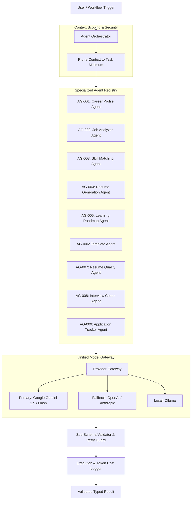

# CAREERFORGE — MULTI-AGENT AI ARCHITECTURE

## 1. Multi-Agent System Overview

CareerForge utilizes a specialized multi-agent architecture where distinct, self-contained AI agents handle dedicated reasoning domains. Agents are not monolithic; they operate under a central orchestrator that enforces context pruning, strict JSON schemas via Zod, and deterministic anti-hallucination boundaries.



---

## 2. Agent Registry & Specifications

### AG-001: Career Profile Agent
- **ID:** `AG-001`
- **Purpose:** Analyzes raw profile entries, suggests improvements to weak bullet points, converts passive statements into action-oriented achievements, and calculates completeness scores.
- **Input:** Candidate profile record.
- **Output Schema:** Suggested bullet rewrites, detected missing domains, profile score.

### AG-002: Job Analyzer Agent
- **ID:** `AG-002`
- **Purpose:** Ingests unformatted job descriptions and extracts structured requirements.
- **Input:** Raw job description text.
- **Output Schema:**
  ```json
  {
    "company": "String",
    "title": "String",
    "requiredSkills": ["String"],
    "preferredSkills": ["String"],
    "responsibilities": ["String"],
    "tools": ["String"],
    "keywords": ["String"]
  }
  ```

### AG-003: Skill Matching Agent
- **ID:** `AG-003`
- **Purpose:** Computes the mathematical and contextual compatibility between a verified candidate profile and job requirements.
- **Rules:** Absolute prohibition against inventing matches without candidate profile evidence.
- **Output Schema:**
  ```json
  {
    "overallScore": 84,
    "matchedSkills": ["TypeScript", "Next.js", "PostgreSQL"],
    "partialMatches": ["AWS (candidate has basic Cloudflare/GCP)"],
    "missingSkills": ["Kubernetes", "Kafka"],
    "scoreExplanation": "Candidate satisfies 90% of core frontend and full-stack requirements, but lacks distributed queuing experience."
  }
  ```

### AG-004: Resume Generation Agent
- **ID:** `AG-004`
- **Purpose:** Selects and shapes candidate experiences into a tailored, ATS-compliant resume for a specific target job.
- **Input:** Candidate profile + Job extraction + Match results + Selected template.
- **Guardrails:** Must only emphasize existing projects, technologies, and achievements. No synthetic job roles or degrees.
- **Output Schema:** Structured JSON sections (summary, experiences, projects, skills, education) ready for DOM preview and LaTeX compilation.

### AG-005: Learning Roadmap Agent
- **ID:** `AG-005`
- **Purpose:** Converts missing skills from `AG-003` into an actionable, prioritized self-study plan.
- **Output Schema:** Prioritized skill milestones, curated high-quality free/paid resources, estimated study hours, and practical project suggestions.

### AG-006: Template Agent
- **ID:** `AG-006`
- **Purpose:** Recommends the optimal resume template layout (e.g., modern technical, classical academic, minimal executive) based on the candidate's seniority and target industry.

### AG-007: Resume Quality Agent
- **ID:** `AG-007`
- **Purpose:** Performs automated quality assurance on generated resumes: checks for clichés, evaluates action-verb diversity, verifies ATS keyword density, and checks LaTeX syntax cleanliness.

### AG-008: Interview Coach Agent
- **ID:** `AG-008`
- **Purpose:** Conducts interactive mock interviews tailored to the target job description and the candidate's actual resume.
- **Output:** Behavioral, system design, and technical challenge questions with evaluation rubrics.

### AG-009: Application Tracker Agent
- **ID:** `AG-009`
- **Purpose:** Analyzes the candidate's application pipeline, detects stagnant applications, and suggests follow-up dates and email templates.

---

## 3. Strict Anti-Hallucination & Verification Architecture

To guarantee total factual integrity:
1. **Source Grounding:** `AG-004` (Resume Generation) is prompted with strict constraints:
   > *"You are an ATS optimization assistant. You are strictly forbidden from inventing any work experience, degree, company name, skill, or metric not present in the provided Profile JSON. If a job requirement is missing from the profile, you must NOT add it."*
2. **Post-Generation Diff Validator:** A deterministic TypeScript validator checks every generated skill and technology against the candidate's verified profile skill list. Any hallucinated keyword is automatically flagged or stripped before saving.
3. **Structured Output Enforcement:** Models return responses formatted strictly to a Zod schema using Gemini `responseSchema` or OpenAI JSON Schema mode. If schema parsing fails, the orchestrator triggers an automatic single-retry with error feedback.
