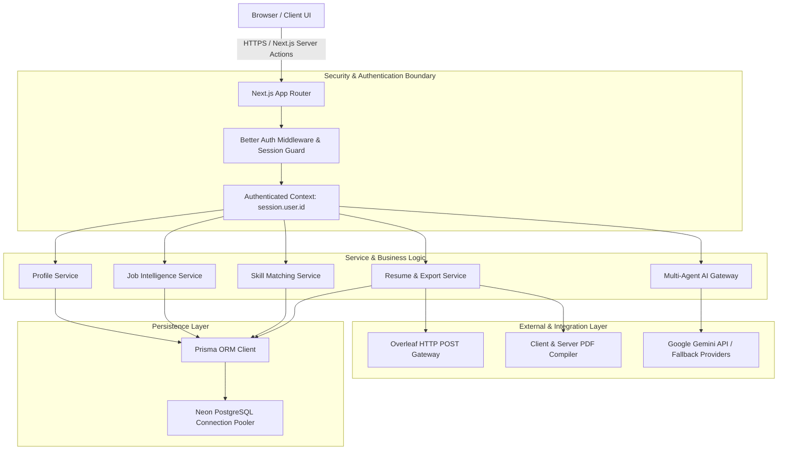

# CAREERFORGE — SYSTEM ARCHITECTURE

## 1. High-Level System Architecture

CareerForge is architected as a modern, full-stack Next.js application using the App Router, backed by Neon Serverless PostgreSQL, Prisma ORM, Better Auth, and an orchestrated multi-agent AI system.



---

## 2. Directory Structure Blueprint

```
careerforge/
├── .env.example                     # Environment template
├── .gitignore                       # Git exclusion rules
├── phases.md                        # Master phase roadmap
├── context.md                       # High-level context
├── ARCHITECTURE.md                  # System architecture
├── DATABASE_DESIGN.md               # Schema & ER diagram
├── API_SPECIFICATION.md             # API & Server Action specs
├── AGENT_ARCHITECTURE.md            # Multi-agent framework specs
├── DEVELOPMENT_ROADMAP.md           # Implementation sequence
├── PHASE_STATUS.md                  # Phase tracking ledger
├── package.json
├── tsconfig.json
├── tailwind.config.ts
├── prisma/
│   ├── schema.prisma                # Complete database schema
│   └── migrations/                  # Versioned SQL migrations
├── src/
│   ├── app/
│   │   ├── (auth)/                  # Auth route group (login, register)
│   │   │   ├── login/page.tsx
│   │   │   └── register/page.tsx
│   │   ├── (dashboard)/             # Protected application pages
│   │   │   ├── layout.tsx           # Dashboard sidebar & top navigation
│   │   │   ├── page.tsx             # Overview & quick metrics
│   │   │   ├── profile/page.tsx     # Career profile editor
│   │   │   ├── jobs/page.tsx        # Job description intelligence
│   │   │   ├── match/page.tsx       # Skill matching & gap engine
│   │   │   ├── builder/page.tsx     # Resume builder & live preview
│   │   │   ├── templates/page.tsx   # Template gallery
│   │   │   ├── tracker/page.tsx     # Application tracker
│   │   │   ├── roadmap/page.tsx     # Learning roadmap
│   │   │   └── interview/page.tsx   # AI mock interview simulator
│   │   ├── api/
│   │   │   ├── auth/[...all]/route.ts # Better Auth endpoint
│   │   │   └── export/
│   │   │       ├── pdf/route.ts     # PDF compilation endpoint
│   │   │       └── latex/route.ts   # LaTeX package generation
│   │   ├── layout.tsx
│   │   └── globals.css
│   ├── components/
│   │   ├── ui/                      # Reusable primitive UI (buttons, dialogs, inputs)
│   │   ├── profile/                 # Profile section components (education, experience, etc.)
│   │   ├── resume/                  # Resume templates & live DOM renderer
│   │   ├── jobs/                    # Job extraction & keyword visualizer
│   │   └── shared/                  # Header, navigation, score badge, loaders
│   ├── lib/
│   │   ├── auth.ts                  # Better Auth server configuration
│   │   ├── auth-client.ts           # Better Auth client hooks
│   │   ├── db.ts                    # Prisma singleton client
│   │   ├── utils.ts                 # Formatting & class merging helpers
│   │   └── latex-templates/         # Raw LaTeX template engines
│   └── server/
│       ├── actions/                 # Next.js Server Actions (type-safe mutations)
│       │   ├── profile.ts
│       │   ├── jobs.ts
│       │   ├── match.ts
│       │   ├── resumes.ts
│       │   └── tracker.ts
│       └── agents/                  # Multi-Agent Framework
│           ├── orchestrator.ts      # Agent router & execution engine
│           ├── gateway.ts           # Multi-provider LLM gateway (Gemini/OpenAI)
│           ├── schemas.ts           # Zod I/O validation schemas
│           └── registry/            # Individual agent definitions
│               ├── ag-001-profile.ts
│               ├── ag-002-job-analyzer.ts
│               ├── ag-003-skill-matcher.ts
│               ├── ag-004-resume-generator.ts
│               ├── ag-005-learning-roadmap.ts
│               ├── ag-006-template.ts
│               ├── ag-007-resume-quality.ts
│               ├── ag-008-interview.ts
│               └── ag-009-tracker.ts
```

---

## 3. Technology Stack Justification

| Layer | Chosen Technology | Justification |
| :--- | :--- | :--- |
| **Framework** | Next.js 15+ (App Router) | Single language stack (TypeScript), Server Components for fast initial loads, Server Actions for zero-boilerplate type-safe backend endpoints. |
| **Database** | Neon PostgreSQL | Serverless Postgres with automatic branching, connection pooling, and AWS us-east-2 low-latency endpoints. |
| **ORM** | Prisma ORM | Strong type safety, auto-generated TypeScript clients, robust migration tooling, seamless relational joins. |
| **Authentication** | Better Auth | Native TypeScript auth engine, database-persisted sessions, row-level tenant security, zero vendor lock-in. |
| **Styling** | Tailwind CSS + Lucide Icons | Utility-first, predictable styling, excellent dark/light theme support, high performance. |
| **AI Layer** | Google Gemini API / AI Gateway | Structured JSON outputs, low latency, generous free tier limits, multimodal capabilities for document parsing. |
| **Export Engines** | Native LaTeX & HTML-PDF | Generates valid standard LaTeX documents; integrates cleanly with Overleaf via standard form submissions without third-party dependencies. |

---

## 4. Multi-Tenant Data Isolation Strategy
- All business entities (Profile, Job, Resume, Application) feature a non-nullable foreign key `userId: String`.
- Server Actions extract the verified `session` directly from Better Auth headers before every read or write.
- Every Prisma query enforces ownership:
  ```typescript
  const resume = await db.resume.findFirst({
    where: { id: resumeId, userId: session.user.id }
  });
  ```
- Unauthorized access attempts immediately return typed authorization rejections.

