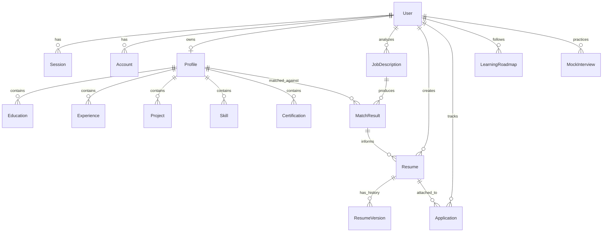

# CAREERFORGE — DATABASE DESIGN SPECIFICATION

## 1. Entity-Relationship Diagram (ERD)



---

## 2. Entity Descriptions & Field Specifications

### Core Authentication Entities (Better Auth Standard)
- **User:** Primary identity record (`id`, `name`, `email`, `emailVerified`, `image`, `createdAt`, `updatedAt`).
- **Session:** Active server session (`id`, `userId`, `token`, `expiresAt`, `ipAddress`, `userAgent`).
- **Account:** Provider link for OAuth/credentials (`id`, `userId`, `accountId`, `providerId`, `password`, `accessToken`, etc.).
- **Verification:** Verification tokens for email validation and password reset.

### Career Profile Entities (Single Source of Truth)
- **Profile:** One-to-one with `User`. Contains personal information, headline, summary, location, phone, GitHub, LinkedIn, portfolio website, and target job titles.
- **Education:** Degree, institution, field of study, start/end dates, GPA/grade, honors, coursework.
- **Experience:** Job title, company, location, employment type, start/end dates, isCurrent, bullet-point achievements, verified technologies used.
- **Project:** Project title, role, live demo URL, repository URL, description, bullet points, key technologies used, highlights.
- **Skill:** Skill name, category (`TECHNICAL`, `SOFT`, `TOOL`, `LANGUAGE`), proficiency level (`BEGINNER`, `INTERMEDIATE`, `ADVANCED`, `EXPERT`).
- **Certification:** Certification title, issuing organization, issue date, expiration date, credential ID, credential URL.

### Job Description Intelligence Entities
- **JobDescription:** Stored job listing (`id`, `userId`, `title`, `company`, `location`, `rawText`, `extractedSkills`, `preferredSkills`, `responsibilities`, `tools`, `keywords`, `createdAt`).
- **MatchResult:** Result of comparing `Profile` and `JobDescription` (`id`, `userId`, `jobId`, `profileId`, `overallScore`, `matchedSkills`, `missingSkills`, `partialMatches`, `scoreExplanation`, `createdAt`).

### Resume & Template Entities
- **Resume:** Generated resume document (`id`, `userId`, `jobId`, `templateId`, `title`, `targetRole`, `contentJson`, `latexSource`, `createdAt`, `updatedAt`).
- **ResumeVersion:** Historical snapshots of a resume for audit and rollback.
- **Template:** System and custom resume templates (`id`, `name`, `category`, `layoutStructure`, `isAtsFriendly`, `latexPreamble`).

### Employability & Career Tracking Entities
- **LearningRoadmap:** Target milestones to bridge skill gaps (`id`, `userId`, `jobId`, `skillName`, `priority`, `recommendedResources`, `estimatedHours`, `isCompleted`).
- **Application:** Job application pipeline (`id`, `userId`, `company`, `role`, `status` [WISHLIST, APPLIED, INTERVIEWING, OFFER, REJECTED], `appliedDate`, `resumeId`, `notes`).
- **MockInterview:** Practice interview records (`id`, `userId`, `jobId`, `interviewType`, `questionsJson`, `transcriptJson`, `feedbackJson`, `score`).

---

## 3. Complete Prisma Schema Specification

```prisma
datasource db {
  provider = "postgresql"
  url      = env("DATABASE_URL")
}

generator client {
  provider = "prisma-client-js"
}

// --------------------------------------------------------
// AUTHENTICATION MODELS (Better Auth)
// --------------------------------------------------------

model User {
  id            String    @id @default(cuid())
  name          String
  email         String    @unique
  emailVerified Boolean   @default(false)
  image         String?
  createdAt     DateTime  @default(now())
  updatedAt     DateTime  @updatedAt

  sessions      Session[]
  accounts      Account[]
  profile       Profile?
  jobs          JobDescription[]
  matchResults  MatchResult[]
  resumes       Resume[]
  applications  Application[]
  roadmaps      LearningRoadmap[]
  interviews    MockInterview[]
}

model Session {
  id        String   @id @default(cuid())
  userId    String
  token     String   @unique
  expiresAt DateTime
  ipAddress String?
  userAgent String?
  createdAt DateTime @default(now())
  updatedAt DateTime @updatedAt
  user      User     @relation(fields: [userId], references: [id], onDelete: Cascade)

  @@index([userId])
}

model Account {
  id                    String    @id @default(cuid())
  userId                String
  accountId             String
  providerId            String
  accessToken           String?
  refreshToken          String?
  idToken               String?
  accessTokenExpiresAt  DateTime?
  refreshTokenExpiresAt DateTime?
  scope                 String?
  password              String?
  createdAt             DateTime  @default(now())
  updatedAt             DateTime  @updatedAt
  user                  User      @relation(fields: [userId], references: [id], onDelete: Cascade)

  @@index([userId])
}

model Verification {
  id         String   @id @default(cuid())
  identifier String
  value      String
  expiresAt  DateTime
  createdAt  DateTime @default(now())
  updatedAt  DateTime @updatedAt
}

// --------------------------------------------------------
// CAREER PROFILE MODELS
// --------------------------------------------------------

model Profile {
  id              String          @id @default(cuid())
  userId          String          @unique
  user            User            @relation(fields: [userId], references: [id], onDelete: Cascade)
  fullName        String?
  headline        String?
  summary         String?
  email           String?
  phone           String?
  location        String?
  websiteUrl      String?
  githubUrl       String?
  linkedinUrl     String?
  targetRoles     String[]        @default([])
  completionScore Int             @default(0)
  createdAt       DateTime        @default(now())
  updatedAt       DateTime        @updatedAt

  educations      Education[]
  experiences     Experience[]
  projects        Project[]
  skills          Skill[]
  certifications  Certification[]
  matchResults    MatchResult[]
}

model Education {
  id           String    @id @default(cuid())
  profileId    String
  profile      Profile   @relation(fields: [profileId], references: [id], onDelete: Cascade)
  institution  String
  degree       String
  fieldOfStudy String
  startDate    DateTime
  endDate      DateTime?
  isCurrent    Boolean   @default(false)
  gpa          String?
  honors       String?
  createdAt    DateTime  @default(now())
  updatedAt    DateTime  @updatedAt

  @@index([profileId])
}

model Experience {
  id           String    @id @default(cuid())
  profileId    String
  profile      Profile   @relation(fields: [profileId], references: [id], onDelete: Cascade)
  company      String
  title        String
  location     String?
  startDate    DateTime
  endDate      DateTime?
  isCurrent    Boolean   @default(false)
  bullets      String[]  @default([])
  technologies String[]  @default([])
  createdAt    DateTime  @default(now())
  updatedAt    DateTime  @updatedAt

  @@index([profileId])
}

model Project {
  id           String    @id @default(cuid())
  profileId    String
  profile      Profile   @relation(fields: [profileId], references: [id], onDelete: Cascade)
  name         String
  role         String?
  description  String
  demoUrl      String?
  repoUrl      String?
  bullets      String[]  @default([])
  technologies String[]  @default([])
  createdAt    DateTime  @default(now())
  updatedAt    DateTime  @updatedAt

  @@index([profileId])
}

enum SkillCategory {
  TECHNICAL
  SOFT
  TOOL
  LANGUAGE
}

model Skill {
  id        String        @id @default(cuid())
  profileId String
  profile   Profile       @relation(fields: [profileId], references: [id], onDelete: Cascade)
  name      String
  category  SkillCategory @default(TECHNICAL)
  level     String?       // Beginner, Intermediate, Advanced, Expert
  createdAt DateTime      @default(now())

  @@index([profileId])
}

model Certification {
  id          String    @id @default(cuid())
  profileId   String
  profile     Profile   @relation(fields: [profileId], references: [id], onDelete: Cascade)
  name        String
  issuer      String
  issueDate   DateTime
  expiryDate  DateTime?
  credentialId String?
  url         String?
  createdAt   DateTime  @default(now())

  @@index([profileId])
}

// --------------------------------------------------------
// JOB INTELLIGENCE & MATCHING
// --------------------------------------------------------

model JobDescription {
  id               String        @id @default(cuid())
  userId           String
  user             User          @relation(fields: [userId], references: [id], onDelete: Cascade)
  company          String
  title            String
  location         String?
  rawText          String
  requiredSkills   String[]      @default([])
  preferredSkills  String[]      @default([])
  responsibilities String[]      @default([])
  tools            String[]      @default([])
  keywords         String[]      @default([])
  createdAt        DateTime      @default(now())
  updatedAt        DateTime      @updatedAt

  matchResults     MatchResult[]
  resumes          Resume[]
  roadmaps         LearningRoadmap[]

  @@index([userId])
}

model MatchResult {
  id               String         @id @default(cuid())
  userId           String
  user             User           @relation(fields: [userId], references: [id], onDelete: Cascade)
  profileId        String
  profile          Profile        @relation(fields: [profileId], references: [id], onDelete: Cascade)
  jobId            String
  job              JobDescription @relation(fields: [jobId], references: [id], onDelete: Cascade)
  overallScore     Int
  matchedSkills    String[]       @default([])
  missingSkills    String[]       @default([])
  partialMatches   String[]       @default([])
  scoreExplanation String
  createdAt        DateTime       @default(now())

  resumes          Resume[]

  @@index([userId])
  @@index([jobId])
}

// --------------------------------------------------------
// RESUMES, TEMPLATES & EXPORT
// --------------------------------------------------------

model Resume {
  id            String          @id @default(cuid())
  userId        String
  user          User            @relation(fields: [userId], references: [id], onDelete: Cascade)
  jobId         String?
  job           JobDescription? @relation(fields: [jobId], references: [id], onDelete: SetNull)
  matchResultId String?
  matchResult   MatchResult?    @relation(fields: [matchResultId], references: [id], onDelete: SetNull)
  title         String
  targetRole    String
  templateName  String          @default("modern-ats")
  contentJson   Json
  latexSource   String?
  createdAt     DateTime        @default(now())
  updatedAt     DateTime        @updatedAt

  versions      ResumeVersion[]
  applications  Application[]

  @@index([userId])
}

model ResumeVersion {
  id          String   @id @default(cuid())
  resumeId    String
  resume      Resume   @relation(fields: [resumeId], references: [id], onDelete: Cascade)
  versionNum  Int
  contentJson Json
  latexSource String?
  note        String?
  createdAt   DateTime @default(now())

  @@index([resumeId])
}

// --------------------------------------------------------
// TRACKING, ROADMAPS & INTERVIEW PREP
// --------------------------------------------------------

enum ApplicationStatus {
  WISHLIST
  APPLIED
  INTERVIEWING
  OFFER
  REJECTED
  ARCHIVED
}

model Application {
  id           String            @id @default(cuid())
  userId       String
  user         User              @relation(fields: [userId], references: [id], onDelete: Cascade)
  company      String
  role         String
  status       ApplicationStatus @default(WISHLIST)
  appliedDate  DateTime?
  resumeId     String?
  resume       Resume?           @relation(fields: [resumeId], references: [id], onDelete: SetNull)
  notes        String?
  interviewDate DateTime?
  createdAt    DateTime          @default(now())
  updatedAt    DateTime          @updatedAt

  @@index([userId])
}

model LearningRoadmap {
  id              String         @id @default(cuid())
  userId          String
  user            User           @relation(fields: [userId], references: [id], onDelete: Cascade)
  jobId           String?
  job             JobDescription? @relation(fields: [jobId], references: [id], onDelete: SetNull)
  skillName       String
  priority        String         // HIGH, MEDIUM, LOW
  recommendations String[]       @default([])
  practicalProject String?
  estimatedHours  Int?
  isCompleted     Boolean        @default(false)
  createdAt       DateTime       @default(now())
  updatedAt       DateTime       @updatedAt

  @@index([userId])
}

model MockInterview {
  id             String   @id @default(cuid())
  userId         String
  user           User     @relation(fields: [userId], references: [id], onDelete: Cascade)
  jobRole        String
  company        String?
  questionsJson  Json
  transcriptJson Json?
  feedbackJson   Json?
  overallScore   Int?
  createdAt      DateTime @default(now())

  @@index([userId])
}
```
