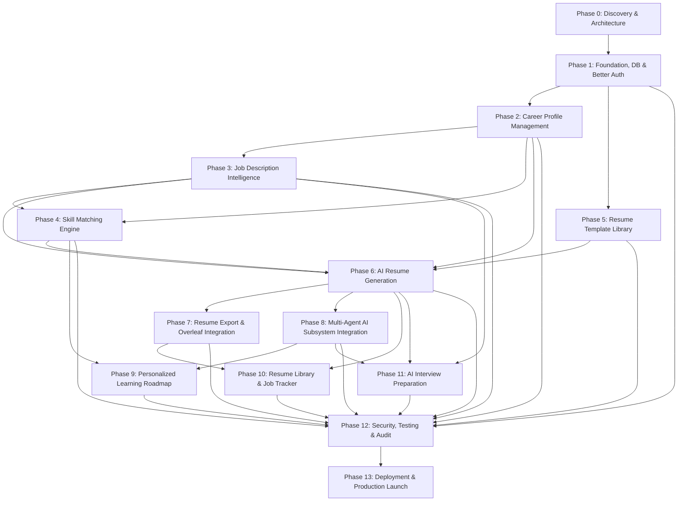

# CAREERFORGE — DEVELOPMENT ROADMAP & EXECUTION PLAN

## 1. Phase Dependency Matrix

---

## 2. Phase-by-Phase Execution Milestones

### Phase 0: Project Discovery & Architecture Blueprint (CURRENT)
- **Goal:** Comprehensive workspace audit, technical blueprinting, and complete documentation.
- **Deliverables:** `context.md`, `ARCHITECTURE.md`, `DATABASE_DESIGN.md`, `API_SPECIFICATION.md`, `AGENT_ARCHITECTURE.md`, `DEVELOPMENT_ROADMAP.md`, `PHASE_STATUS.md`.
- **Status:** **Completed & Awaiting User Approval to Start Phase 1.**

---

### Phase 1: Foundation, Database & Authentication
- **Goal:** Next.js 15 app structure, Neon PostgreSQL connection, Prisma schema migrations, Better Auth session authentication, protected routing.
- **Success Criteria:** User A and User B can register, log in independently, maintain secure sessions, and be strictly isolated in database records.

---

### Phase 2: Career Profile Management
- **Goal:** Central candidate profile builder (Personal, Education, Work, Projects, Skills, Certifications).
- **Success Criteria:** Profiles persist in Neon DB, survive logout/login, and calculate profile completeness scores.

---

### Phase 3: Job Description Intelligence
- **Goal:** Ingestion and AI extraction engine for job descriptions.
- **Success Criteria:** Converts raw job listings into structured records (skills, qualifications, keywords) stored privately per user.

---

### Phase 4: Intelligent Skill Matching Engine
- **Goal:** Deterministic comparison between user profile and analyzed job description.
- **Success Criteria:** Generates compatibility score, matched skills list, and missing competency gaps with transparent explanations. No hallucinated experience.

---

### Phase 5: Resume Template Library
- **Goal:** Professional, ATS-friendly resume template gallery with live interactive preview.
- **Success Criteria:** Modular, reusable template layouts (Modern, Executive, Minimal) ready for dynamic data injection.

---

### Phase 6: AI-Powered Resume Generation
- **Goal:** Tailors user's canonical profile into a target job resume using selected template.
- **Success Criteria:** Zero factual hallucinations; outputs structured JSON and live preview; section-level manual edits supported.

---

### Phase 7: Resume Export & Overleaf Integration
- **Goal:** Multi-format exporter supporting PDF download and standard Overleaf direct opening.
- **Success Criteria:** Generates clean `.tex` packages and standard Overleaf POST integration without undocumented APIs. Fully functional without an Overleaf account.

---

### Phase 8: Multi-Agent AI Architecture
- **Goal:** Registry and orchestrator for agents `AG-001` through `AG-009`.
- **Success Criteria:** Model gateway supporting Gemini with fallback chains, Zod schema validation, and context pruning.

---

### Phase 9: Personalized Learning Roadmap
- **Goal:** Targeted employability roadmaps based on identified skill gaps.
- **Success Criteria:** Prioritized skills, curated learning resources, and progress tracking saved to the user account.

---

### Phase 10: Resume Library & Job Application Tracker
- **Goal:** Centralized repository for all resume versions and application pipeline (Wishlist, Applied, Interviewing, Offer).
- **Success Criteria:** Users can attach specific resumes to job applications and track status updates over time.

---

### Phase 11: AI Interview Preparation
- **Goal:** Job-specific mock interviews and answer evaluation.
- **Success Criteria:** Role-specific question generation and constructive, actionable feedback stored per session.

---

### Phase 12: Security, Testing & Optimization
- **Goal:** Multi-user tenant isolation tests, end-to-end integration tests, and performance audit.
- **Success Criteria:** Zero cross-tenant data leaks, all unit/e2e tests passing, production build verification.

---

### Phase 13: Deployment & Production Launch
- **Goal:** Public online deployment with Neon DB connection pooling, HTTPS, and health monitoring.
- **Success Criteria:** Live production URL accessible to users with verified registration and persistence.
