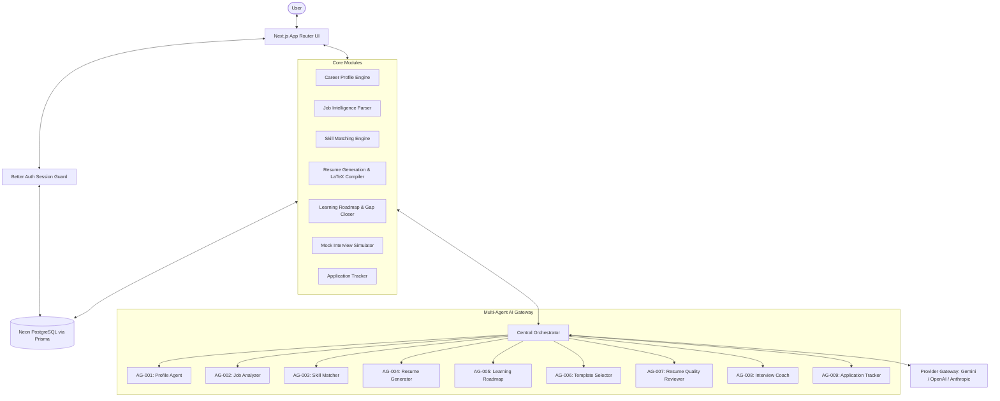

# CareerForge — Product & System Context

## 1. Executive Summary
**CareerForge** is a production-grade, AI-powered career intelligence and resume engineering platform. Rather than acting as a superficial generative text wrapper, CareerForge combines relational data modeling, rigorous multi-user security, deterministic skill-matching algorithms, and an orchestrated multi-agent AI system.

The platform empowers job seekers to maintain a comprehensive, single source of truth for their career history, parse and analyze target job descriptions, discover genuine skill gaps with quantifiable scores, generate ATS-optimized and LaTeX-formatted resumes, export directly to Overleaf or PDF, and prepare for interviews with targeted AI mock sessions.

---

## 2. Core Personas
1. **The Active Job Seeker:** Applying to varied roles (e.g. Full-Stack Engineer vs. DevOps Specialist), requiring tailored, factual resumes emphasizing relevant projects without manual re-formatting.
2. **The Career Switcher / Student:** Needs deep gap analysis between current coursework/projects and target roles, actionable roadmaps to close missing skills, and targeted interview preparation.
3. **The Professional Engineer / Academic:** Demands high typesetting standards (LaTeX / Overleaf), clean PDF exports, and zero AI hallucinations in their technical credentials.

---

## 3. High-Level System Architecture & Flow

---

## 4. Key Functional Modules

### A. Career Profile Management (Single Source of Truth)
- Persistent structured storage: Personal bio, education history, work experience, internships, technical skills, soft skills, projects with verified tech stacks, certifications, and portfolio links.
- Strictly partitioned by authenticated `userId`.
- Reused across all downstream generation and evaluation engines.

### B. Job Description Intelligence
- Ingests raw job descriptions (text paste or file upload).
- Structured extraction: Company name, job title, required technical skills, preferred qualifications, responsibilities, tooling, and domain keywords.
- Saved per-user for historical tracking and comparative matching.

### C. Deterministic & AI-Assisted Skill Matching
- Compares user's career profile against target job criteria.
- Computes compatibility score based on verified profile evidence.
- Explicitly flags: Direct skill matches, partial matches, and missing critical competencies.
- **Rule of Truth:** Never fabricates experience or matches that have no backing evidence in the user's profile.

### D. Resume Generation & Multi-Format Export
- Dynamic selection from professional, ATS-compliant templates.
- Section-level customization and targeted bullet-point optimization.
- Multi-format compilation:
  - Clean client-side/server-side PDF generation.
  - Native LaTeX source generation with downloadable `.tex` packages.
  - Official, standard-compliant Overleaf direct workflow ("Open in Overleaf" form submission).

### E. Multi-Agent AI Subsystem (`AG-001` - `AG-009`)
- Unified orchestrator with strict context scoping (passing only the minimal required payload to each agent).
- Schema-enforced outputs using Zod.
- Model gateway with automatic retry logic, cost tracking, and fallback options.

### F. Learning Roadmaps & Interview Preparation
- Actionable, prioritized milestones to close identified job gaps.
- Job-specific mock interviews featuring technical, architectural, behavioral, and resume-defense questions.

---

## 5. Non-Negotiable System Principles
1. **Strict Factual Accuracy:** Generation agents are prohibited from fabricating credentials, skills, companies, dates, or metrics.
2. **Multi-Tenant Data Isolation:** All database queries and server actions must verify session ownership (`WHERE userId = session.user.id`).
3. **Decoupled Architecture:** Each phase builds upon verified foundations. Agent modules are self-contained with typed contracts.
4. **Resilient Exporting:** Works natively without requiring an Overleaf account, while providing seamless Overleaf integration for LaTeX enthusiasts.
